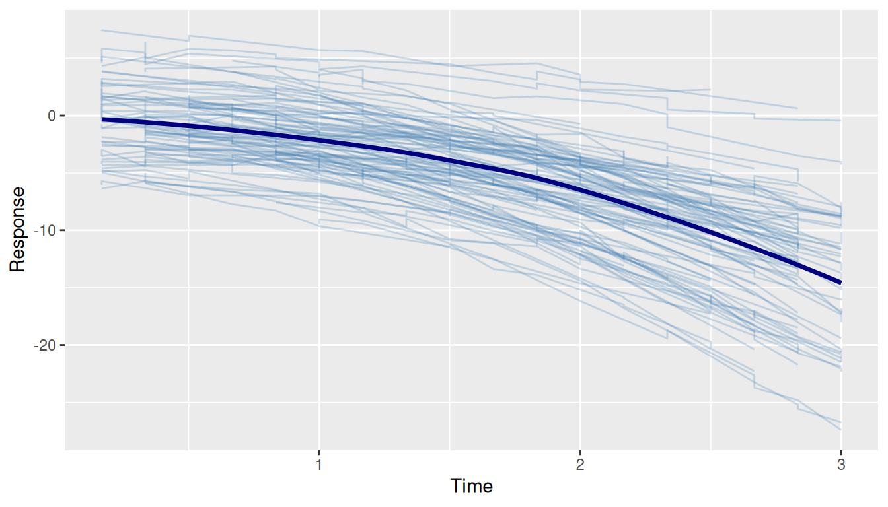
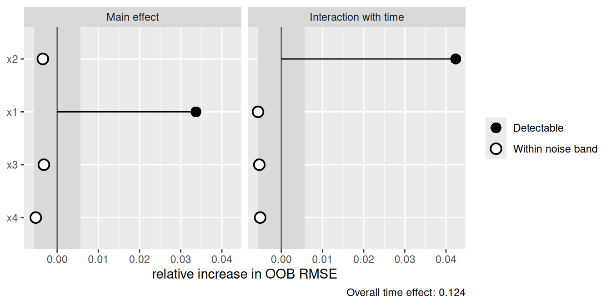
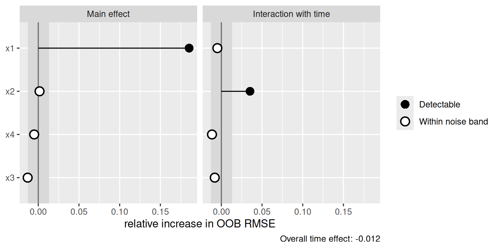
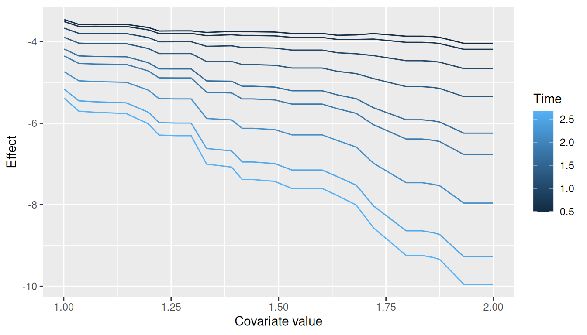
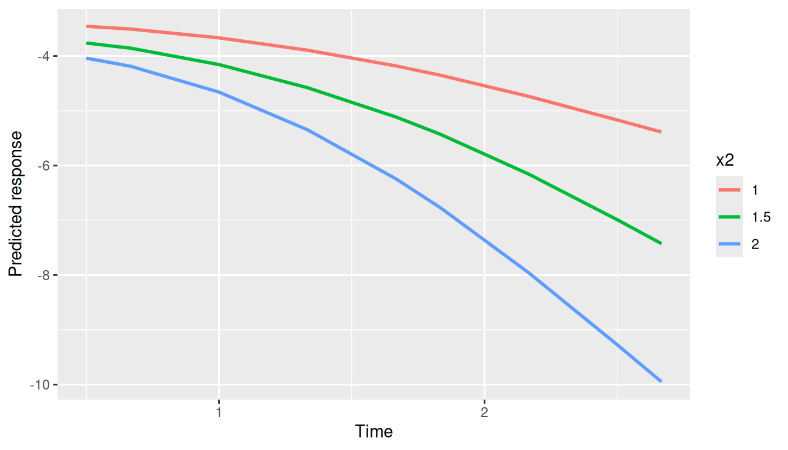
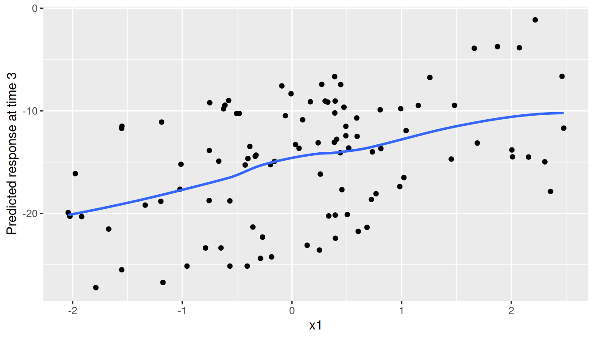

# Four Figures From One boostmtree Fit

A longitudinal boosted-tree analysis is usually reported with four
figures: the subjects’ trajectories, which covariates matter, how the
important ones shape the trajectory, and what the model predicts at a
landmark time. This article builds each one from a single `boostmtree`
fit, says what it is asking, and says how to read the answer. All four
start from the same fit; no figure refits the model.

## The fit

We simulate 100 subjects with up to six visits each. `simLong()` model 2
builds the response as `2.5 x1 - 1.2 x3 - 0.2 x4` plus a term in
`time^2 x2^2`. So `x1` shifts a subject’s whole trajectory, while `x2`
enters only through time: it changes the *shape* of the trajectory, not
its starting level. `x3` and `x4` enter with smaller coefficients.
Knowing the truth lets us check what each figure finds, and what it
misses.

``` r

library(ggBoostedTrees)
library(ggplot2)

set.seed(11)
sim <- boostmtree::simLong(n = 100, n.time = 6, model = 2)$data.list

fit <- boostmtree::boostmtree(
  x = sim$features, tm = sim$time, id = sim$id, y = sim$y,
  M = 100, cv.flag = TRUE, verbose = FALSE,
  control = boostmtree::boostmtree.control(seed = 11)
)
```

`cv.flag = TRUE` is needed for two of the figures below: variable
importance is computed from the out-of-bag subjects that
cross-validation sets aside, and the fixed-time prediction uses the
cross-validated number of iterations.

## A. How do subjects change over follow-up?

The first figure is every subject’s measured response over time, with
the average trend drawn over the top. It is a picture of the data,
before any model is involved, and it sets the scale for everything after
it: how much subjects vary, how much a single subject wanders, and
whether the average moves at all.

[`gg_boost_trajectory()`](https://ehrlinger.github.io/ggBoostedTrees/reference/gg_boost_trajectory.md)
returns one row per observation, with each subject’s observed values in
time order. For the published style, observed values as faint lines with
a smoothed mean, draw the extracted data directly. That is what the
extraction step is for:

``` r

traj <- gg_boost_trajectory(fit)
ggplot(traj, aes(time, observed)) +
  geom_line(aes(group = id), alpha = 0.25, colour = "steelblue") +
  geom_smooth(method = "loess", formula = y ~ x, se = FALSE,
              colour = "navy", linewidth = 1.2) +
  labs(x = "Time", y = "Response")
```



**Reading it.** The spread of the faint lines at any one time is the
between-subject variation the model has to explain. A flat mean does not
mean nothing happens over time; it can hide subjects moving in opposite
directions, which is exactly what a covariate-by-time interaction
produces.

The numbers-at-risk strip that often sits under this figure (patients
and measurements per time interval) is not drawn by the package. It is a
count of `traj` by time bin, `table(cut(traj$time, breaks))`, and can be
added as a table or annotation layer.

## B. Which covariates matter, and do their effects change over time?

`boostmtree` scores each covariate twice. The **main effect** asks how
much worse the model predicts when the covariate is scrambled. The
**interaction with time** asks how much worse it predicts when only the
covariate’s *time-varying* part is scrambled. A covariate can matter a
great deal for the level of the response and not at all for how it
changes, and this figure is how you tell the two apart.

``` r

set.seed(11)
vimp <- boostmtree::vimp.boostmtree(fit)
autoplot(gg_boost_vimp(vimp))
```



**Reading it.** Read a row across both panels. `x1` has a long stem
under *Main effect* and nothing under *Interaction with time*: it raises
or lowers a subject’s whole trajectory without changing its shape. `x2`
is the reverse: it has no detectable main effect and a clear
interaction, so it changes how the response evolves. That is what the
simulation built in. `x3` and `x4` are in the simulation too, but with
smaller coefficients, and at 100 subjects neither clears the band. A
hollow dot means “not detected in this fit”, not “has no effect”.

The importance is the relative increase in out-of-bag error, so 0.3
means the error rose 30% when that covariate was scrambled. A covariate
that contributes nothing scores near zero, and is as likely to land
slightly below zero as slightly above. The negative values are therefore
a ruler for noise: the grey band runs from minus to plus the largest of
them. A filled dot on a stem lies to the right of the band. A hollow dot
lies inside it, and you should not read anything into it, whichever side
of zero it falls.

The caption reports the **overall time effect**: how much worse the
model predicts when time itself is scrambled. A value near zero says the
average trajectory is flat; a large one says the response changes over
follow-up. It answers a different question from the per-covariate
interactions.

### When there is no time interaction

Model 0 builds the response as `2.5 x1 - 1.2 x3 - 0.6 x4`, with no time
term and no `x2` at all, so no covariate can truly interact with time:

``` r

set.seed(12)
sim0 <- boostmtree::simLong(n = 100, n.time = 6, model = 0)$data.list
fit0 <- boostmtree::boostmtree(
  x = sim0$features, tm = sim0$time, id = sim0$id, y = sim0$y,
  M = 100, cv.flag = TRUE, verbose = FALSE,
  control = boostmtree::boostmtree.control(seed = 12)
)
autoplot(gg_boost_vimp(boostmtree::vimp.boostmtree(fit0)))
```



Two things to notice. The overall time effect is about zero, correctly:
the response does not change over follow-up. And `x2`, which is not in
the model at all, still has an interaction that clears the band. The
band is set by the largest negative value among only eight, so it is a
rough ruler, and with several covariates one of them can clear it by
chance. A lone, small interaction with a near-zero time effect is a
reason to look at figure C for that covariate, not a finding on its own.

When every interaction falls inside the band, the panel says *None
detectable*. That is a finding, not a failure: the covariates shift
trajectories up or down but none changes their shape, and a
time-varying-effect claim is not supported.

Both panels share one horizontal scale, so the interactions are judged
against the main effects. A small interaction is drawn small.

## C. How does an important covariate shape the trajectory?

Importance says *whether* a covariate matters; this figure says *how*.
It draws the predicted trajectory over time at several values of one
covariate, holding the others at their reference values. That is a
**partial effect**.

[`boostmtree::partial.plot()`](https://rdrr.io/pkg/boostmtree/man/partial.plot.boostmtree.html)
computes it and
[`gg_boost_effect()`](https://ehrlinger.github.io/ggBoostedTrees/reference/gg_boost_effect.md)
extracts it. The default plot puts the covariate on the x axis with one
curve per time:

``` r

pp <- boostmtree::partial.plot(
  fit, x.var.names = "x2", output = "data", verbose = FALSE
)
eff <- gg_boost_effect(pp)
autoplot(eff)
```



For the published orientation, response over time with one curve per
covariate value, swap the roles in the extracted data:

``` r

keep <- sort(unique(eff$x))[c(1, 13, 25)]
ggplot(eff[eff$x %in% keep, ],
       aes(time, estimate, colour = factor(signif(x, 2)))) +
  geom_line(linewidth = 1) +
  labs(x = "Time", y = "Predicted response", colour = "x2")
```



**Reading it.** Parallel curves mean the covariate’s effect is the same
at every time, which is what a main effect alone draws. Curves that
converge, cross or fan out mean its effect changes over follow-up, which
is what a time interaction draws. Here the `x2` curves fan out: small
and large values of `x2` start close together and separate over time.
This figure is where the interaction found in figure B becomes something
you can describe in a sentence.

The curves are smooth in time because `boostmtree` models time with a
B-spline basis. They step in the covariate, because the base learners
are trees.

## D. What does the model predict at a landmark time?

A partial effect holds every other covariate fixed. This figure does
not: it predicts each subject’s response at one time (say, the end of
follow-up) using that subject’s own covariates, and plots the
predictions against one covariate. The smoother traces the trend; the
scatter around it is the spread that all the other covariates produce.

``` r

t_end <- max(unlist(fit$time))
pred <- gg_boost_prediction(fit, time = t_end)
plot(pred, covariate = "x1")
```



**Reading it.** A clear slope in the smoother says the covariate moves
the landmark prediction. A flat smoother over a wide scatter says it
does not, and that the other covariates drive the differences between
subjects. Here the smoother rises with `x1`, matching its large main
effect.

Two cautions.

- These are **in-sample** predictions from `predict.boostmtree()` at the
  cross-validated number of iterations: each subject’s own data helped
  grow the trees, so they fit the data more closely than the model would
  fit a new subject. They are not the `mu` stored on the fit, and a
  subject’s dot here need not match that value at the same time.
- `time` must be inside the observed follow-up.
  [`gg_boost_prediction()`](https://ehrlinger.github.io/ggBoostedTrees/reference/gg_boost_prediction.md)
  refuses a later time rather than extrapolate the B-spline time basis.

## Summary

| Figure | Question | Code |
|----|----|----|
| A | How do subjects change over follow-up? | `gg_boost_trajectory(fit)` |
| B | Which covariates matter, and does their effect change over time? | `gg_boost_vimp(vimp.boostmtree(fit))` |
| C | How does one covariate shape the trajectory? | `gg_boost_effect(partial.plot(fit, ...))` |
| D | What is predicted at a landmark time, across subjects? | `gg_boost_prediction(fit, time)` |

Read them in that order. A says how much there is to explain, B says
which covariates explain it and whether any change the shape of the
trajectory, C shows the shape, and D brings it back to individual
subjects at the time a clinician would ask about.
